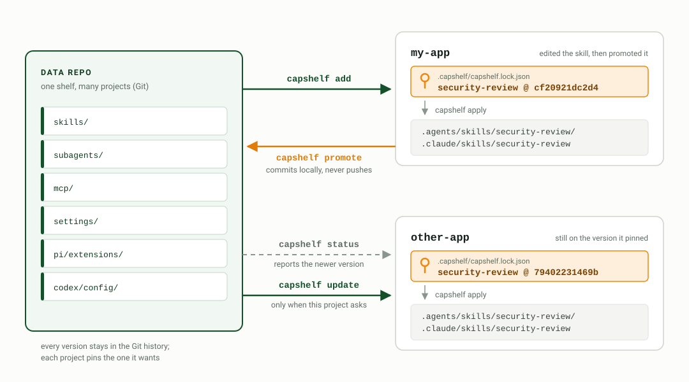
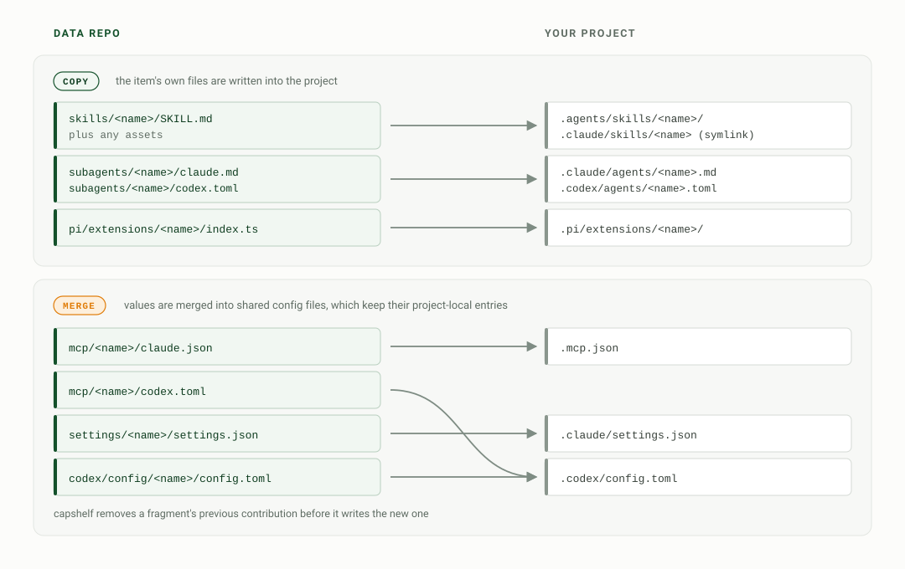
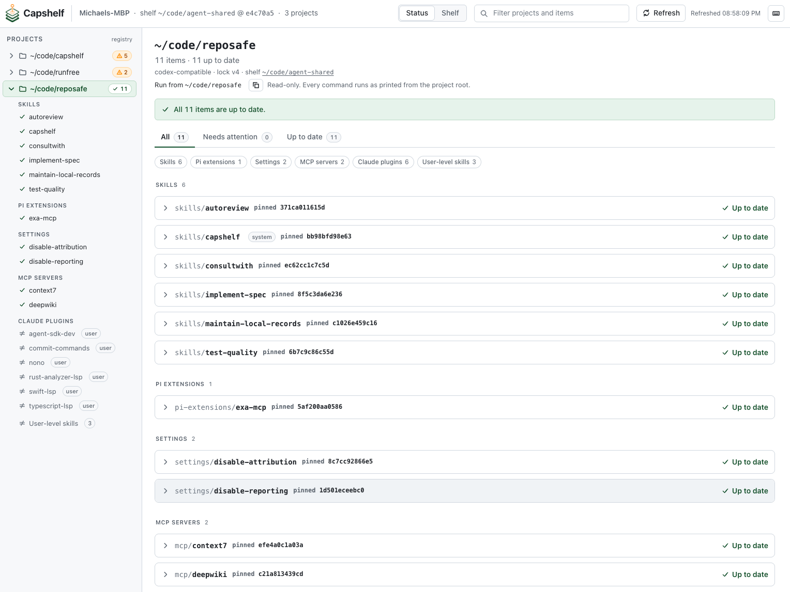

<p align="center">
  
</p>
<h1 align="center">Capshelf</h1>
<h3 align="center">Share agent skills and config across your repos. Pin a version per project.</h3>
<p align="center">Works with Claude Code, Codex CLI, and Pi.</p>
<p align="center">
<a href="https://github.com/genged/capshelf/actions/workflows/release.yml">
  
</a>
<a href="https://github.com/genged/capshelf/releases/latest">

</a>

</p>

Keep your skills, subagents, settings, and MCP servers in one Git repo. Each
project pins the version it uses. An edit in one project changes no other
project until that project runs `capshelf update`.

**No account. No hosted service. Capshelf never pushes.**

As you add projects, you add copies of the same skills, settings, and MCP
servers. Copy them by hand and every project drifts out of date. Symlink the
whole directory and an edit for one project changes all of them. You get no
diff and no local variant.

## How it works

<p align="center">
  <picture>
    <source media="(prefers-color-scheme: dark)" srcset="docs/diagram-flow-dark.svg">
    
  </picture>
</p>

Four words carry the model:

- A **data repo** is a Git repo that holds your shared items. The CLI calls
  its contents the **shelf**.
- A **pin** is an entry in a project's lock. It records the exact version of
  one shared item.
- **Drift** is a difference between a project's files and its pin.
- To **promote** is to commit a local edit back to the data repo.

The recording runs the loop. `other-app` installs a shared skill from the
picker. `my-app` edits its copy and promotes the edit. `other-app` keeps its
pin until it runs `capshelf update`.

<p align="center">
  
</p>

The same loop as text. The output is shortened.

```console
# my-app already has security-review. other-app installs it.
$ cd ~/code/other-app
$ capshelf add security-review
✓ added project/data/skills/security-review @ 79402231469b

# my-app: edit the skill, then look at the drift
$ cd ~/code/my-app
$ $EDITOR "$(capshelf get-path security-review)/SKILL.md"
$ capshelf status security-review --diff
  ✎   data/skills/security-review             79402231469b  drifted (1 file: content-edit)
+- parameterized queries assumed; flag every f-string in a query

# my-app: commit the edit to the data repo (local commit, no push)
$ capshelf promote security-review -m "tighten SQLi check"
✓ promoted data/skills/security-review @ cf20921dc2d4…

# other-app: still on its pin, and told that an update exists
$ cd ~/code/other-app
$ capshelf status security-review
  ⚠   data/skills/security-review             79402231469b  update available → cf20921dc2d4…
```

## Try it in two minutes

This trial creates a local data repo with no remote. It changes only the
project you run it in.

```bash
brew trust --formula genged/tap/capshelf
brew install genged/tap/capshelf
```

Look before you set anything up. This command needs no project and no data
repo. It lists the skills in your user folders, `~/.claude/skills/` for
Claude and `~/.agents/skills/` or `~/.codex/skills/` for Codex:

```bash
capshelf ls --user
```

The trial needs a project with at least one skill under `.agents/skills/` or
`.claude/skills/`. If your project has none, create one:

```bash
cd ~/code/my-app
mkdir -p .agents/skills/hello
printf -- '---\nname: hello\ndescription: Smoke test.\n---\n\nReply with "capshelf is working".\n' \
  > .agents/skills/hello/SKILL.md
```

Then create the data repo and connect the project:

```bash
git init ~/agent-config
git -C ~/agent-config commit --allow-empty -m "initialize shared agent config"

cd ~/code/my-app
capshelf init --data ~/agent-config --no-upstream
capshelf share       # mark the skills this project already has, then press enter
capshelf status
```

`capshelf share` with no argument opens a picker, so it needs an interactive
terminal. In a script, name the item: `capshelf share skills/<name> --to
project -m "<message>"`.

`status` lists each shared skill next to the `capshelf` system skill that
`init` installs:

```console
$ capshelf status
/home/agent/code/my-app  (2 items)

project/
  ✓   system/skills/capshelf                  57e5655fc9a5  up-to-date

local/  (from ~/agent-config)
  ✓   data/skills/hello                       43367a9f1c30  up-to-date
```

The picker shares a skill in local scope. The skill is on the shelf, but the
project's committed lock does not list it. To make it a team item, run
`capshelf move skills/<name> --to project`.

Now run `capshelf init --data ~/agent-config --no-upstream` in a second
project, then `capshelf add`. The picker shows the skills that the first
project shared.

For a data repo that your team pushes to, see
[Install and set up](#install-and-set-up).

## Edit in one project. The others stay put.

Edit a shared skill in place. `status --diff` shows the drift against the pin.
Then choose what happens to the edit:

```bash
$EDITOR "$(capshelf get-path security-review)/SKILL.md"
capshelf status security-review --diff

capshelf promote security-review -m "tighten security review checklist"
# or keep the edit in this project only:
capshelf keep-local security-review --reason "project-specific review rules"
# or discard the edit:
capshelf revert security-review --yes
```

`promote` updates the lock of the current project only. Every other project
keeps its pin until it runs `capshelf update`.

A newer version can arrive on the shelf while you still have an edit. To keep
your edit and take the new version, merge them in the project:

```bash
capshelf update security-review --merge
capshelf status security-review --diff-view installed   # review the result
```

`update --merge` does a three-way merge into the installed copy and publishes
nothing. A conflict lists the files and changes nothing. The merge works for
skills and Pi extensions.

## Your agent runs it. You approve.

`init` installs a `capshelf` skill into the project. Your agent reads it and
knows the commands. You ask in plain words, and the agent runs the command:

> You: "Send my edit of security-review back to the shelf."
>
> Agent: `capshelf promote security-review -m "tighten SQLi check"`

A human does three things:

1. Approve a `promote` when the agent proposes it.
2. Look at `capshelf status` when work on a project starts.
3. Make the policy decisions for a new project.

The agent does the rest: inspect, edit, share, move, promote, and reconcile.
Each command supports `--json` where an agent needs it, and the exit codes are
stable. A destructive change asks for consent in a terminal. Without a
terminal, it refuses unless you add `--yes`.

An agent finds items with `capshelf search`. It matches the name, the tags,
the description, and the content:

```bash
capshelf search "sql injection"
```

A data repo can tag its items and declare relations between them. When an
item `requires` another item, `add` warns and prints the install command.
When an item `conflicts-with` an installed item, `add` refuses.

## Teams review in pull requests. CI fails on drift.

A team shares one data repo on its Git host. A change to a shared item goes
through the same review as code:

```bash
# Alice, in ~/code/billing
capshelf promote security-review -m "add SQLi checklist"
git -C ~/code/agent-shared push      # or open a pull request

# Bob, in ~/code/checkout
capshelf data sync                   # fetch and fast-forward the data repo
capshelf status
capshelf update security-review
```

`promote` refuses when the data repo holds a newer version than the one the
project pinned, so it does not overwrite a teammate's change by accident. To
overwrite on purpose, add `--stale-ok`.

In CI, `capshelf status --strict` exits 4 when an item is not up to date
and not marked `keep-local`. It also exits 4 on a strict warning. Examples:

- Installed files differ from the lock.
- An installed copy is missing.
- A pinned commit is missing from the data repo. In CI, the data repo is a
  fresh clone of the upstream.
- An update is available.
- A personal Claude skill or a Pi project skill hides a managed skill.

The full GitHub Actions job, private data repos, and the review recipe are in
[`docs/team-workflow.md`](docs/team-workflow.md). The trust model per item
kind is in [`docs/security.md`](docs/security.md).

### Keep a skill for yourself in a team project

Skills and Pi extensions can use local scope. A local item is on your shelf,
but the project's committed lock does not list it. Capshelf adds its paths to
`.git/info/exclude`. A teammate who clones the project does not install it.

Local scope is not private. The item is committed to the data repo, so anyone
who can read that repo can read the item. Keep private content on a personal
shelf.

```bash
capshelf share skills/my-notes -m "my review notes"   # no --to project: local scope
capshelf add skills/my-notes --local                  # in another project
capshelf move skills/my-notes --to project            # later, give it to the team
```

## Try a skill from any repo. Adopt it when it earns a place.

`capshelf add <url>` installs a skill from any Git repository, not only from
your shelf:

```bash
capshelf add https://github.com/acme/pdf-skills --list            # look, install nothing
capshelf add https://github.com/acme/pdf-skills --path skills/pdf
capshelf status --check-upstream                                   # which remote items moved
capshelf share skills/pdf --adopt -m "adopt the pdf skill"         # put it on your shelf
```

Before it installs, `add` prints the repository, the commit, the file list,
and the license finding. Then it asks once. A gitignored record,
`.capshelf/remotes.lock.json`, tracks the skill, so your teammates do not get
it. You cannot promote a remote skill. `share --adopt` copies it onto your
shelf and records where it came from. See Remote skills in
[`docs/cli.md`](docs/cli.md).

The same command installs a whole Claude Code plugin. A plugin skill can read
agents and scripts from the rest of its plugin, so a copy of the skill alone
can break it:

```bash
capshelf add https://github.com/acme/agent-plugins --path plugins/gh-cli
capshelf share plugins/gh-cli --adopt -m "adopt gh-cli"            # onto your shelf
capshelf move plugins/gh-cli --to project                          # give it to the team
```

A plugin can run hooks and MCP servers with no request from the agent. The
prompt lists each command before the install. Capshelf asks again when an
update adds a command, and when a write commits the plugin for the team.
After an adopt, capshelf does not follow the upstream. See Plugins in
[`docs/cli.md`](docs/cli.md).

## Settings and MCP merge. Your local values stay.

<p align="center">
  <picture>
    <source media="(prefers-color-scheme: dark)" srcset="docs/diagram-kinds-dark.svg">
    
  </picture>
</p>

Capshelf copies skills, plugins, Pi extensions, and subagents into the project. It
merges settings, MCP, and Codex config fragments into the files your agents
read, and it keeps the values that the project set locally.

| Kind | Data repo path | Project output |
|---|---|---|
| `skills` | `skills/<name>/SKILL.md` plus assets | `.agents/skills/<name>/` and `.claude/skills/<name>` symlink |
| `plugins` | `plugins/<name>/.claude-plugin/plugin.json` plus the whole plugin directory | the same folder as a skill of that name |
| `pi-extensions` | `pi/extensions/<name>/index.ts` plus local modules | `.pi/extensions/<name>/` |
| `subagents` | `subagents/<name>/claude.md`, `subagents/<name>/codex.toml` | `.claude/agents/<name>.md` and/or `.codex/agents/<name>.toml` |
| `settings` | `settings/<name>/settings.json` | merged into `.claude/settings.json` |
| `codex-config` | `codex/config/<name>/config.toml` | merged into `.codex/config.toml` |
| `mcp` | `mcp/<name>/claude.json`, `mcp/<name>/codex.toml` | merged into `.mcp.json` and/or `.codex/config.toml` |

One MCP server or subagent item can carry a source for Claude and a source
for Codex. `add`, `show`, and `status` tell you which runtime the item covers.
For a runtime it does not cover, they name the file that the data repo needs.

`promote settings/<name>` commits the fragment's source file in the data repo.
The merged output is a product of that source. `share --pick` takes an
unmanaged value out of a project's merged output and puts it on the shelf.

Bundles are curated sets of items. A bundle installs all of its members or
none of them. After the install, each member is an independent item in the
lock. Worked examples for fragments, `--pick`, Pi extensions, subagents, and
bundles are in [`docs/cli.md`](docs/cli.md).

## Works with

| Item kind | Claude Code | Codex CLI | Cowork / claude.ai | Pi |
|---|:---:|:---:|:---:|:---:|
| Skills | ✓ `.claude/skills/` ᵇ | ✓ `.agents/skills/` | ✓ ᵃ | ✓ `.agents/skills/` ᵉ |
| Plugins | ✓ `.claude/skills/` ᶠ | skills only | ✗ | ✗ |
| Subagents | ✓ `.claude/agents/` | ✓ `.codex/agents/` | ✗ | ✗ |
| Settings | ✓ `.claude/settings.json` ᵈ | ✓ `.codex/config.toml` ᵈ | ✗ | ✗ |
| MCP fragments | ✓ `.mcp.json` | ✓ `.codex/config.toml` | ✗ | ✗ |
| Pi extensions | n/a | n/a | n/a | ✓ `.pi/extensions/` |
| Plugin catalogs | ✓ authored ᶜ | ✓ generated projection | ✓ `.plugin` pack upload | ✗ |

- ᵃ Cowork receives skills through a `.plugin` pack from `marketplace plugin
  pack`, not through project files.
- ᵇ In the default layout `.claude/skills/<name>` is a symlink to
  `.agents/skills/<name>`. `init --claude-only` writes real directories there.
- ᶜ Authored directly in the data repo's `.claude-plugin/marketplace.json`.
  See [`docs/marketplaces.md`](docs/marketplaces.md).
- ᵈ Merged into the file. Project-local values are preserved.
- ᵉ Pi reads `.agents/skills/` and ranks a same-name `.pi/skills/` entry above
  it. `status` warns when that hides a managed skill.
- ᶠ Claude Code loads the folder as `<name>@skills-dir`, with its agents,
  hooks, and MCP servers, in a trusted workspace only.

Capshelf runs on macOS and Linux, on arm64 and x64. It needs `git` 2.40 or
newer on your `PATH`.

## What Capshelf never does

- It never pushes. Sharing upstream is a separate `git push` in the data repo.
- It never syncs the data repo in the background. These commands reach the
  network: `init` when it clones a data repo, `data sync`, `self-update`,
  `add <url>`, and `status --check-upstream`. `capshelf ui` makes no
  outbound connection. One exception: an interactive Homebrew install runs
  `brew outdated` to offer an update. Homebrew can update its own data over
  the network first. A successful check is cached for 24 hours. A failed
  check runs again on the next command. Set `CAPSHELF_NO_SELF_UPDATE=1` to
  stop that check.
- It never changes a project that did not ask for the change.
- It never overwrites the values a project set in a merged config file.
- It never edits skills managed by `skills.sh`, Claude marketplace plugins,
  personal `~/.claude/skills/` entries, or Pi project skills under
  `.pi/skills/`. It lists the first three as external state.
  `share --adopt` is the one way a `skills.sh` skill changes hands.
- It never installs, refreshes, or removes plugins through a Claude or Codex
  marketplace. It writes and commits the catalog files that those runtimes
  read. A `plugins/<name>` item is a folder that capshelf copies, the same as
  a skill.
- It does not sandbox Pi extensions or manage their `package.json`
  dependencies, `.pi/settings.json`, or Pi reloads.

A personal Claude skill or a Pi project skill with the same name as a managed
skill hides that skill from its harness. `status` warns, and `--strict`
fails.

Pi extensions and Codex project config need trust in their runtime. A Pi
extension runs arbitrary code after Pi project trust, and Capshelf reports
that warning. Codex loads a project `.codex/config.toml` only in a trusted
project. Capshelf writes the file. It warns when it finds signs that Codex
will ignore the file.

## Compared with copies and symlinks

| | Copy by hand | Symlink a shared directory | Capshelf |
|---|:---:|:---:|:---:|
| Each project stays on its own version | ✓ | ✗ | ✓ |
| A local edit shows as a diff | ✗ | ✗ | ✓ |
| A local edit can go back to the shared copy | by hand | ✓, to every project at once | ✓, with `promote` |
| A project can keep a local variant | ✓ | ✗ | ✓, with `keep-local` |
| A fresh clone gets the same versions | ✗ | ✗ | ✓, from the committed lock |
| Settings and MCP merge with local values | ✗ | ✗ | ✓ |
| CI can fail on drift | ✗ | ✗ | ✓ |

Capshelf works next to `skills.sh` and plugin marketplaces. It does not
replace them. It reports their skills and leaves them alone. It can also
write Claude and Codex plugin catalogs from the skills in your data repo.

## Install and set up

### 1. Install Capshelf

```bash
brew trust --formula genged/tap/capshelf
brew install genged/tap/capshelf
```

Homebrew requires trust for formulae from third-party taps. Run the trust
command once per machine. Without that entry, `brew upgrade` skips Capshelf
and says nothing about it.

Without Homebrew, use the install script. It downloads the latest GitHub
release for your platform, verifies its SHA-256 checksum, and installs to
`~/.local/bin/capshelf`:

```bash
curl -fsSL https://raw.githubusercontent.com/genged/capshelf/main/scripts/install.sh | sh
```

To build from this repo instead:

```bash
bun install
make install     # builds dist/capshelf and copies it to ~/.local/bin/capshelf
```

Make sure `~/.local/bin` is on your `PATH` when you use the install script or
the source install.

Homebrew installs can check for and apply binary updates:

```bash
capshelf self-update --check
capshelf self-update
```

Source installs update manually with `git pull && make install`. Startup
self-update prompts are best-effort, cached, and only shown for interactive
Homebrew installs. Set `CAPSHELF_NO_SELF_UPDATE=1` to disable them.

### 2. Create the data repo

The data repo is a second Git repo, separate from every project that uses it.
Create it once. Every project you connect later reads from it. In the
commands, replace `YOUR_ACCOUNT` with your account or organization.

```bash
mkdir -p ~/code/agent-config
cd ~/code/agent-config
git init
git remote add origin https://github.com/YOUR_ACCOUNT/agent-config
git commit --allow-empty -m "initialize shared agent config"
```

`init` reads `origin` and
records it as `dataRepoUpstream`, so later clones find the same source. Point
it at a repo you can push to. For a local sandbox with no remote, add
`--no-upstream` to the `init` command in the next step.

### 3. Connect a project

Bind the project, then look at the shelf:

```bash
cd ~/code/my-app
capshelf init --data ~/code/agent-config
capshelf ls
```

A new shelf is empty. Move a skill that this project already has into the
data repo. Capshelf commits it there and tracks it here:

```bash
capshelf share skills/security-review --to project \
  -m "share existing security-review skill"
capshelf status
```

That works for any skill under `.agents/skills/<name>/` or
`.claude/skills/<name>/`. Repeat it in each repository that holds skills you
want to share.

If you have no skills yet, create one so the loop has something to carry:

```bash
mkdir -p .agents/skills/hello
cat > .agents/skills/hello/SKILL.md <<'EOF'
---
name: hello
description: Smoke test. Confirms capshelf is installed and a data repo is bound.
---

Reply with "capshelf is working".
EOF
capshelf share skills/hello --to project -m "add hello skill"
capshelf status
```

By default, skills install under `.agents/skills/<name>/`, and Claude sees
them through `.claude/skills/<name>` symlinks. Use `capshelf init
--claude-only --data <repo>` to write real skill directories directly under
`.claude/skills/`.

### Two repos, side by side

After step 3 you have both. A data repo holds items at the top level. A
project holds `.capshelf/` pins and the installed copies:

```text
~/code/agent-config/                 the data repo
  skills/security-review/SKILL.md
  mcp/github/claude.json

~/code/my-app/                       a project that uses it
  .capshelf/                         manifest and lock
  .agents/skills/security-review/    installed copy
```

Capshelf accepts a project's own path as `--data` and reports success. That
makes the project its own shelf, private to itself. Keep the two separate.

One data repo serves many projects. You can keep more than one, for example
a work shelf and a personal shelf. Bind each project to the one it needs.

### Join a data repo that already has items

If your team already has one, skip step 2 and bind to your clone of it:

```bash
cd ~/code/my-app
capshelf init --data ~/code/agent-shared
capshelf status
```

`init` ends by showing you the shelf. Type to filter it, press `tab` to mark
each item you want, and press `enter` to install them. Press `esc` to skip.
The project is initialized either way. Run `capshelf add` with no arguments to
open the same list again.

The picker matches loose subsequences, not only substrings: `secrev` finds
`security-review`. A menu across the top selects the item kind, and `left`
and `right` move between kinds.

Use `add` for an item the data repo already holds. Use `share` to put an item
there for the first time. `capshelf share` with no item finds untracked
skills, Pi extensions, subagents, and unmanaged config values. `capshelf
promote` with no item opens the same kind of picker over the tracked items.

`capshelf init --data <url>` starts a project directly from a data repo URL.
Plain `capshelf init` connects a fresh clone through its committed
`dataRepoUpstream`. Both are in Getting started in
[`docs/cli.md`](docs/cli.md).

## Reference

### The web UI

`capshelf ui` shows the same facts for every project on the machine, in a
read-only dashboard on localhost. It shows which items are behind, drifted, or
missing, the diff behind each state, and the command to run. See
[the web UI](docs/cli.md#the-web-ui).

<p align="center">
  
</p>

### Mental model

Capshelf is a declarative reconciler, not a package installer:

- `capshelf.lock.json` is the spec.
- `capshelf apply` makes the project files match that spec.
- `capshelf status` shows the plan before anything changes.
- `capshelf update` moves selected pins to the current data repo content.
- `capshelf promote` commits local edits to the data repo and updates only
  the current project's lock.

### The `.capshelf/` directory

```text
.capshelf/
  capshelf.json        committed manifest: install mode, upstream, declared items
  capshelf.lock.json   committed lock: committed-tree digest and source commit
  local.json           gitignored: data repo path plus clone-local copy-item intent
  local.lock.json      gitignored: clone-local item pins
  .gitignore           written by capshelf: the rule that ignores those two files
```

The lock is the safety boundary. A data item's identity is its committed Git
tree. The pin is a SHA-256 digest over the sorted `(name, mode, blobId)`
entries that the data repo holds at the pinned commit. This calculation reads
no file content. Working-tree state, Git configuration, and checkout filters
cannot change what a pin means. System items bundled in the CLI are pinned by
content hash plus CLI version.

### Commands

The verbs: `init`, `add`, `rm`, `status`, `apply`, `update`, `share`,
`move`, `promote`, `keep-local`, `revert`, `get-path`, `ls`, `show`,
`search`, `lock migrate`, `self-update`, `ui`, the `data` subcommands, and
the `marketplace` family. The full table with flags, JSON shapes, and exit
codes is in [`docs/cli.md`](docs/cli.md).

### Project status

| Capability | State | Reference |
|---|---|---|
| Skills, plugins, project-local Pi extensions, Claude/Codex subagents | shipped | [item kinds](docs/cli.md#item-kinds) |
| Settings, MCP, and project-scoped Codex config fragments | shipped | [config fragments](docs/cli.md#config-fragments) |
| Bundles: curated item sets, installed all or nothing | shipped | [bundles](docs/cli.md#bundles) |
| Item metadata driving `ls --tag`, `search`, and `requires`/`conflicts-with` | shipped | [item metadata](docs/cli.md#item-metadata) |
| Claude/Cowork and Codex plugin catalogs in the data repo | shipped | [plugin marketplaces](docs/cli.md#plugin-marketplaces) |
| `validate`, `diff`, `doctor`, `journal` | roadmap | n/a |

## Development

```bash
bun install
bun run src/cli.ts <verb> [args]   # run from source
bun run test                       # unit tests (4 workers)
bun run lint                       # Biome, then Oxlint with the anti-slop plugin
make smoke                         # smoke suites (4 workers)
make e2e                           # build dist/capshelf, then run the e2e suite
make check                         # typecheck, lint, docs freeze, tests, smoke, e2e
make build                         # compile dist/capshelf
bun run build:ui                   # bundle the web UI (bun install runs it too)
```

The end-to-end suite, and therefore `make check`, also needs `python3` on
your `PATH` for the terminal cells.

This repository holds code only. Shared items live in a separate data repo.
The smoke targets in the `Makefile` each create a temporary data repo, so the
tests do not depend on a local fixture. For daily development, set
`CAPSHELF_HOME` to a test data repo, for example `~/code/capshelf-data`. Then
`init` does not need `--data` each time.

To record the demo again, run `./docs/demo/setup.sh`, then `vhs
docs/demo/demo.tape` from the repository root. The setup script builds a
sandbox under `/tmp/capshelf-demo` and compiles the binary that the tape runs.
Recording needs [VHS](https://github.com/charmbracelet/vhs).

The test layers are in [`docs/testing.md`](docs/testing.md). Guidance for
coding agents that work in this repo is in [`AGENTS.md`](AGENTS.md).

## Further reading

- [`docs/cli.md`](docs/cli.md): full command reference, flags, exit codes
- [`docs/architecture.md`](docs/architecture.md): data model and rationale
- [`docs/team-workflow.md`](docs/team-workflow.md): team loop, `data sync`, review recipe, CI drift gate
- [`docs/security.md`](docs/security.md): trust model, threat model per item kind, guidance for teams
- [`docs/marketplaces.md`](docs/marketplaces.md): Claude/Cowork and Codex plugin catalogs in the data repo
- [`docs/testing.md`](docs/testing.md): the four test layers and the rules the harness enforces

### Release history

The latest release is described in
[`docs/whats-new-0.14.md`](docs/whats-new-0.14.md).

<details>
<summary>All releases</summary>

- [`docs/whats-new-0.14.md`](docs/whats-new-0.14.md): Claude Code plugins as items, plugin consent, whole plugins from a repository URL, lock version 5
- [`docs/whats-new-0.13.md`](docs/whats-new-0.13.md): remote skills from any repository URL, `--check-upstream`, `share --adopt`, faster status reports
- [`docs/whats-new-0.12.md`](docs/whats-new-0.12.md): the `capshelf ui` dashboard, the project registry, Pi shadow warnings, no more `promote --merge`
- [`docs/whats-new-0.11.md`](docs/whats-new-0.11.md): interactive pickers for setup, sharing, and promotion, plus publication previews
- [`docs/whats-new-0.10.md`](docs/whats-new-0.10.md): `update --merge`, both diff views in `status --diff`, complete file-tree diffs, end-to-end suite
- [`docs/whats-new-0.9.md`](docs/whats-new-0.9.md): runtime target coverage for mcp and subagents, pin-sourced fragment installs, gated Codex trust warning
- [`docs/whats-new-0.8.md`](docs/whats-new-0.8.md): Git-tree source pins, lock version 4 and `lock migrate`, filtered-content refusal, classified drift
- [`docs/whats-new-0.7.md`](docs/whats-new-0.7.md): destructive-change consent, preserved local files, keep-local intent, init recovery
- [`docs/whats-new-0.6.md`](docs/whats-new-0.6.md): subagents, plugin marketplaces, declared needs, stale-promote merges
- [`docs/whats-new-0.5.1.md`](docs/whats-new-0.5.1.md): clone-local reconciliation and recovery fixes
- [`docs/whats-new-0.5.md`](docs/whats-new-0.5.md): Pi extensions, user skill inventory, safer CLI behavior
- [`docs/whats-new-0.4.md`](docs/whats-new-0.4.md): remote bootstrap, metadata + search, team sync, bundles

</details>
